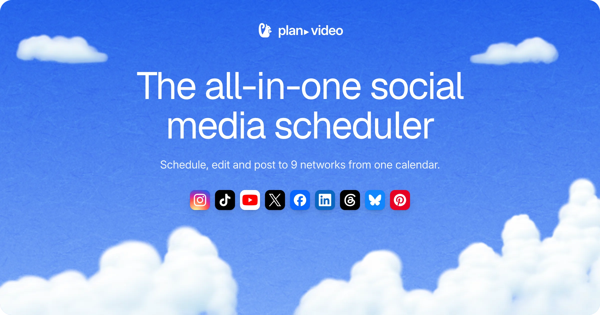
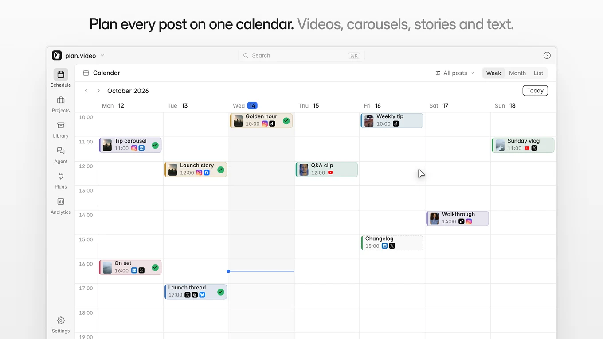
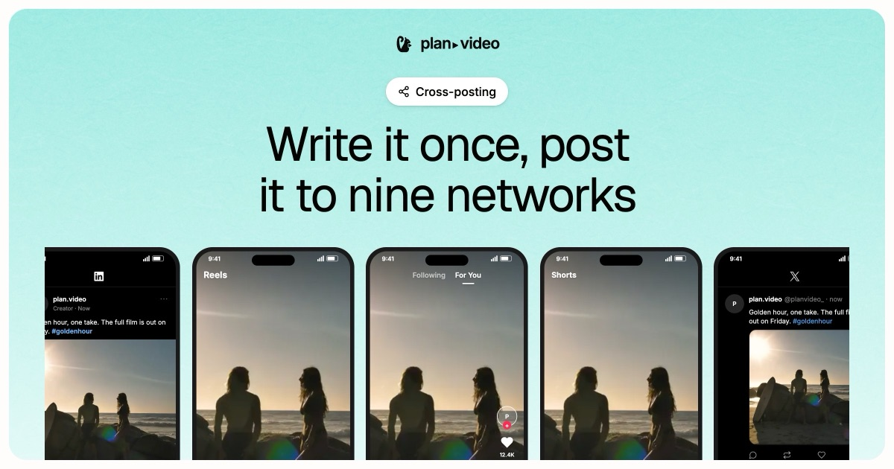
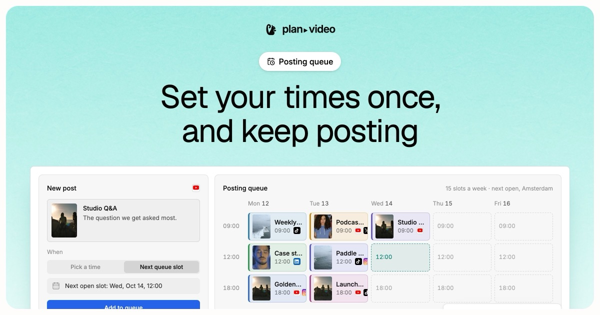
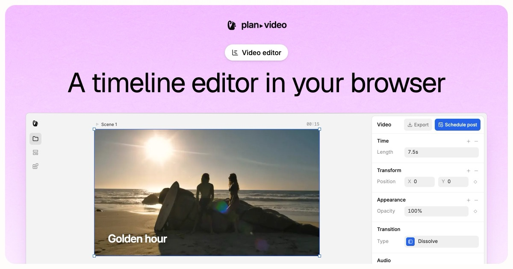
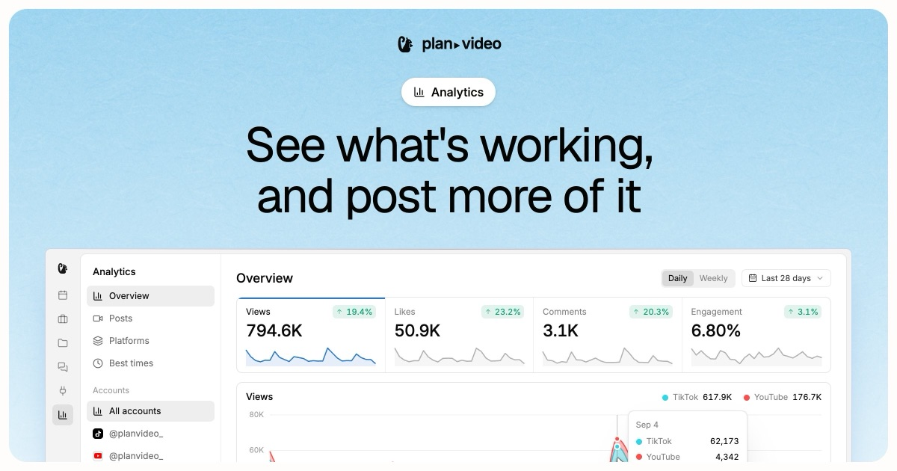
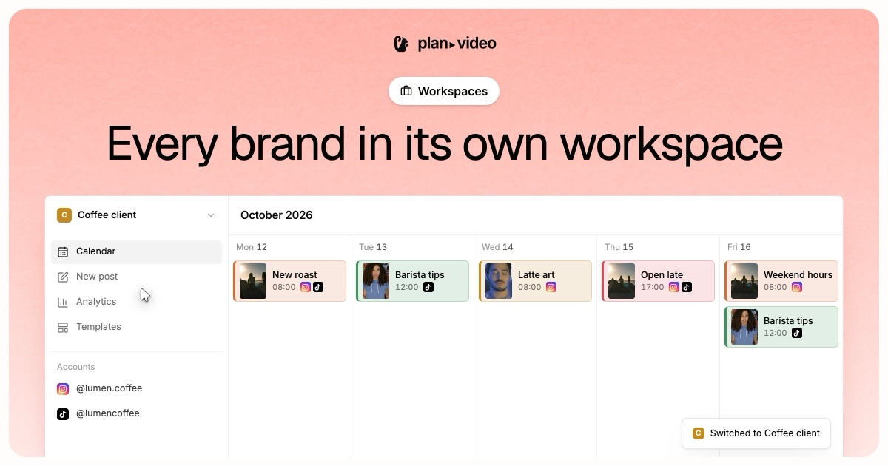
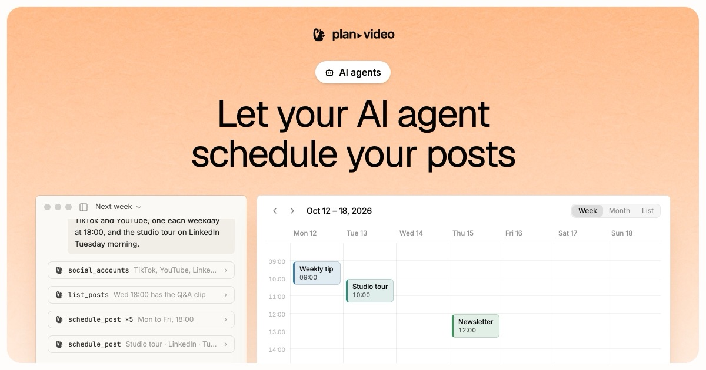

<a href="https://plan.video"></a>

<p align="center">
  <a href="https://plan.video"><b>Website</b></a> ·
  <a href="https://plan.video/docs"><b>Docs</b></a> ·
  <a href="https://plan.video/roadmap"><b>Roadmap</b></a> ·
  <a href="https://discord.gg/4C3g9FZsyr"><b>Discord</b></a>
</p>

# plan.video

The all-in-one social media scheduler. Schedule posts to 9 networks, with a video editor built in.

**[Start free at plan.video](https://plan.video)**: the hosted version runs this same code, with the networks' developer apps already registered, so there's nothing to set up.

<picture>
  <source media="(prefers-color-scheme: dark)" srcset=".github/assets/calendar-dark.webp">
  
</picture>

## What's in it

- **A calendar and posting queue** for YouTube, TikTok, X, LinkedIn, Bluesky, Instagram, Facebook, Threads and Pinterest.
- **A video editor in the browser**, with captions, transcript cutting and transitions.
- **Analytics** for what you've posted.
- **Workspaces and team members**, with shared posts and comments.
- **AI agents**: connect Claude, Claude Code, Codex, Cursor and others at `plan.video/mcp` and let them schedule posts for you.

<table>
  <tr>
    <td width="50%"><a href="https://plan.video/features/cross-posting"></a></td>
    <td width="50%"><a href="https://plan.video/features/posting-queue"></a></td>
  </tr>
  <tr>
    <td width="50%"><a href="https://plan.video/features/timeline-editor"></a></td>
    <td width="50%"><a href="https://plan.video/features/analytics"></a></td>
  </tr>
  <tr>
    <td width="50%"><a href="https://plan.video/features/workspaces"></a></td>
    <td width="50%"><a href="https://plan.video/features/ai-agents"></a></td>
  </tr>
</table>

## Run it locally

You need Node.js 22, npm, git and a Chromium browser.

```bash
git clone https://github.com/plan-video/plan-video.git
cd plan-video
npm install
npm run dev -w @plan.video/web
```

Open [http://localhost:5173/try](http://localhost:5173/try) for the dashboard and editor with sample posts. You need no account or keys for that, and nothing is ever sent.

To sign in, post and turn on more, see [Local development](apps/web/src/content/docs/local-development.md).

## The repository

```text
apps/web     the dashboard and editor (SolidJS, Vite, Tailwind CSS)
packages/    the editor's engine and shared code
services/    the server's services: the publisher, billing, each network, and more
supabase/    the database's migrations, policies and email templates
scripts/     tools for installing, translating and releasing
```

More in [The repository](apps/web/src/content/docs/repository.md) and [Architecture](apps/web/src/content/docs/architecture.md).

## Self-hosting

You can run plan.video yourself: the dashboard and editor, the services that post for you and the database. (plan.video's own homepage and marketing pages aren't part of this repository; your copy opens straight into the dashboard.) You'll need a Linux server, a Supabase project, a Cloudflare R2 bucket and your own developer app on each network. See [Self-hosting](apps/web/src/content/docs/self-hosting.md).

## Contributing

Fixes, features, translations and docs are all welcome. Read [CONTRIBUTING.md](CONTRIBUTING.md) first, and ask anything in the [Discord community](https://discord.gg/4C3g9FZsyr).

Found a security problem? Please don't open an issue: see [SECURITY.md](SECURITY.md).

## License

plan.video is under the [GNU Affero General Public License v3.0](LICENSE). Files that carry the MPL notice stay under the [Mozilla Public License 2.0](LICENSES/MPL-2.0.txt). See [NOTICE](NOTICE).

The plan.video name and logos are trademarks and aren't covered by these licenses: if you run or share a changed version, give it a name of its own. Contributors sign the [Contributor License Agreement](CLA.md).
